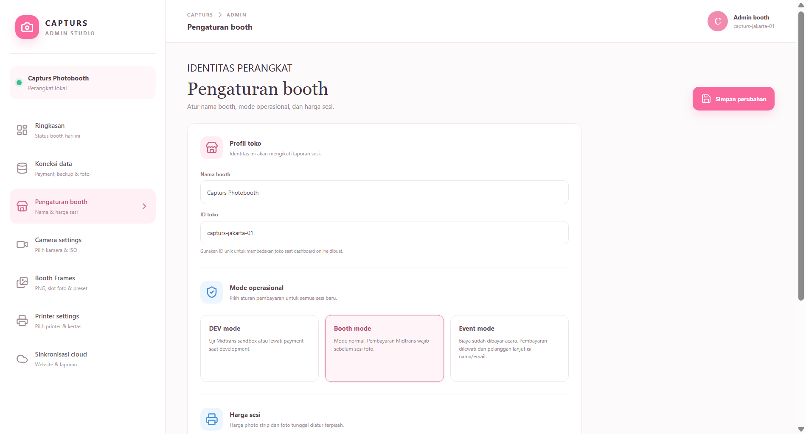
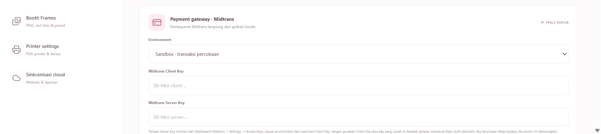
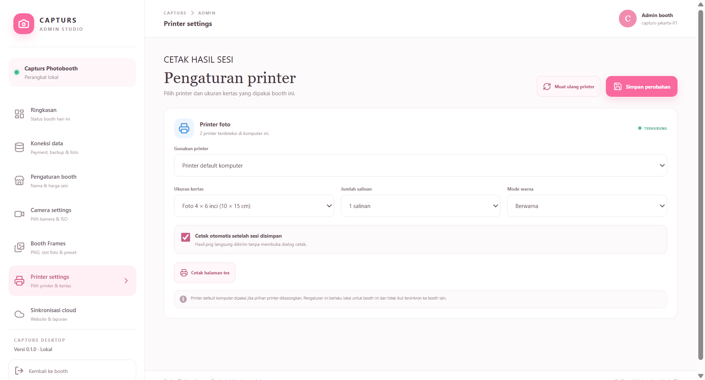
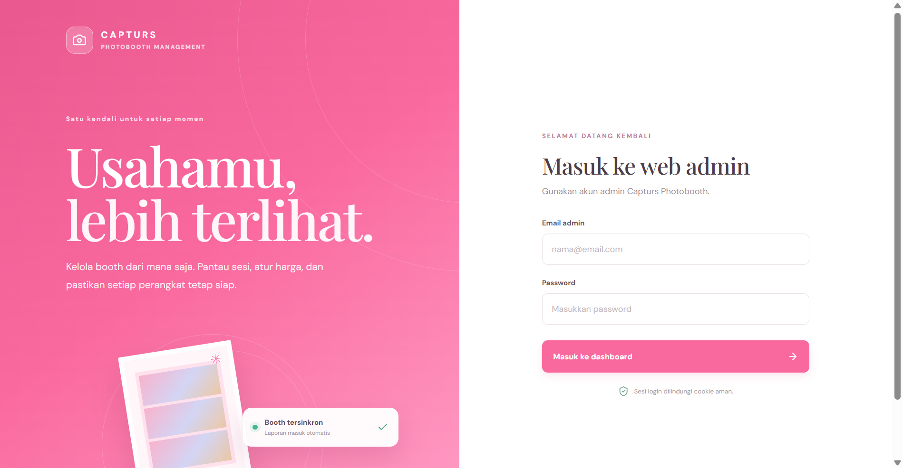
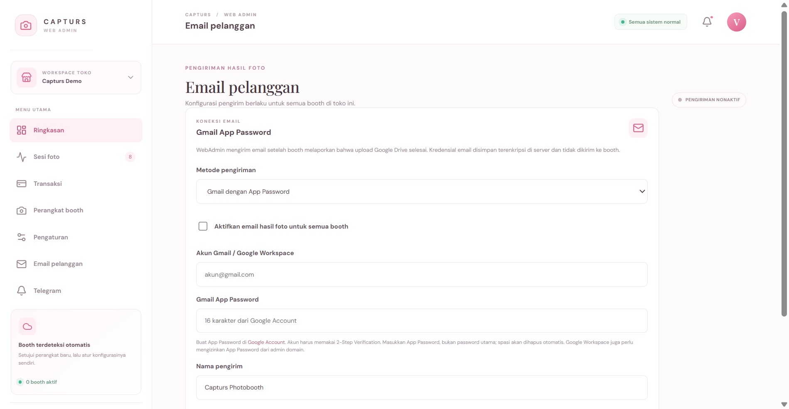

# Panduan Setup Booth Capturs untuk Vendor

> Panduan teknisi/vendor untuk menyiapkan booth sebelum diserahkan kepada operator acara atau dibuka untuk pelanggan.

## Urutan setup

1. Pastikan komputer booth terhubung ke internet, kamera dan printer terpasang, serta aplikasi Capturs dapat dibuka.
2. Dari menu utama, tekan `Ctrl+Z` untuk membuka Admin Studio. Password aplikasi saat ini adalah `admin`.
3. Isi profil booth dan pilih mode yang benar: **Booth** untuk pembayaran per pelanggan atau **Event** jika biaya sesi sudah ditanggung penyelenggara.
4. Siapkan Midtrans untuk Booth mode, Google Drive untuk upload/QR, URL WebAdmin untuk pelaporan/email, serta printer yang akan dipakai.
5. Simpan setiap perubahan dan lakukan pemeriksaan sebelum booth diberikan kepada operator.

> Untuk transaksi sungguhan, pastikan booth menggunakan **Booth mode**. DEV mode mengizinkan pembayaran dilewati.

## Masuk ke Admin Studio di aplikasi booth

1. Buka aplikasi Capturs sampai halaman awal booth muncul.
2. Tekan `Ctrl+Z` pada keyboard.
3. Masukkan password `admin`, lalu pilih **Buka menu admin**.
4. Pilih halaman pengaturan dari menu di sisi kiri Admin Studio.

Screenshot di panduan ini menggunakan data contoh. Isi nama dan ID toko, koneksi, serta pengaturan sesuai informasi dari pemilik booth.

## Setup Booth mode

1. Buka **Admin Studio → Pengaturan booth**.
2. Isi **Nama booth** dan **ID toko** sesuai data yang diberikan pemilik. Gunakan ID toko yang sama dengan toko di WebAdmin.
3. Pilih **Booth mode**. Mode ini mewajibkan pembayaran Midtrans yang berhasil diverifikasi sebelum sesi foto dimulai.
4. Isi harga **Photo strip** dan **Foto tunggal**. Harga keduanya berdiri sendiri.
5. Atur **Batas waktu sesi**. Default aplikasi adalah 5 menit; nilai yang diizinkan 1–60 menit. Hitung mundur mulai setelah pembayaran berhasil.
6. Buka **Koneksi data → Midtrans**, atur environment dan kedua key sesuai langkah Midtrans di bawah, lalu simpan perubahan.
7. Jalankan satu transaksi Sandbox untuk memastikan Snap terbuka dan status pembayaran dapat terverifikasi. Sebelum menerima pembayaran pelanggan, ganti ke Production beserta Production keys.

Screenshot Admin Studio di atas menunjukkan **Booth mode** yang dipilih. Harga photo strip, harga foto tunggal, dan batas waktu sesi diatur pada halaman yang sama.

### Jika Booth mode belum disiapkan

- Jika mode Booth dipilih tetapi Midtrans belum lengkap atau key tidak cocok, pelanggan tidak dapat menyelesaikan pembayaran dan sesi foto tidak dimulai.
- Jika booth dibiarkan di DEV mode, pembayaran bisa dilewati. Jangan gunakan DEV mode untuk operasi berbayar.
- Jika internet booth putus, aplikasi tidak dapat membuat atau memverifikasi transaksi Midtrans. Sesi tetap menunggu pembayaran terkonfirmasi.

## Setup Event mode

1. Buka **Admin Studio → Pengaturan booth**.
2. Pilih **Event mode** sebelum pelanggan mulai menggunakan booth.
3. Pastikan biaya sesi memang sudah dibayar oleh penyelenggara. Midtrans tidak digunakan untuk menagih pelanggan satu per satu.
4. Simpan perubahan. Pelanggan memilih format foto, memasukkan email, lalu langsung masuk ke sesi.
5. Jika Event mode dipakai bersama WebAdmin, Drive, atau email pelanggan, siapkan koneksi terkait pada bagian berikut.

### Jika Event mode belum disiapkan

- Jika booth masih di Booth mode, pelanggan akan diminta membayar melalui Midtrans meskipun acara sudah menanggung biaya.
- Jika Event mode dipakai untuk penjualan normal, aplikasi tidak menagih pelanggan melalui Midtrans dan tidak membuat transaksi berbayar per pelanggan. Ringkasan sesi tetap dapat tercatat jika URL WebAdmin tersambung.
- Harga photo strip dan foto tunggal tetap dapat diatur, tetapi tidak ditagihkan melalui Midtrans selama Event mode.

## Setup Google Drive

Google Drive bersifat opsional. Hasil foto tetap disimpan di komputer booth dan masih dapat dicetak tanpa Drive.

### Buat kredensial Google

1. Di [Google Cloud Console](https://console.cloud.google.com/), pilih atau buat project untuk akun pemilik booth.
2. Aktifkan **Google Drive API** pada project tersebut.
3. Siapkan layar persetujuan OAuth dan informasi kontak aplikasi sesuai petunjuk Google.
4. Buat OAuth Client dengan tipe **Desktop app**.
5. Simpan **Client ID** dan **Client Secret** dari OAuth client yang sama. Aplikasi Capturs meminta kedua nilai ini.
6. Untuk pemakaian rutin, atur consent screen ke **Production**. Bila masih di mode Testing, aplikasi dapat kehilangan refresh token setelah 7 hari dan akun Drive perlu dihubungkan ulang.

### Hubungkan akun pada booth

1. Buka **Admin Studio → Koneksi data → Upload foto & QR Google Drive**.
2. Isi OAuth Client ID dan Client Secret.
3. Klik **Hubungkan akun Google**, pilih akun pemilik Drive yang akan dipakai, lalu setujui permintaan akses.
4. Aktifkan **Upload & QR otomatis**.
5. Isi folder tujuan (default `Capturs`) dan lama retensi (default 7 hari; 1–3650 hari).
6. Klik **Simpan perubahan**, lalu **Tes koneksi Drive**. Pastikan nama akun yang terhubung benar.

### Jika Google Drive belum disiapkan

- Tidak ada upload foto ke Drive atau QR folder hasil.
- Email hasil foto tidak dapat menyertakan tautan folder Drive. Hasil tetap tersimpan lokal dan cetak tetap bisa berjalan.
- Email pemberitahuan sesi timeout tanpa foto tetap bisa dikirim tanpa Drive, tetapi URL WebAdmin dan pengiriman email WebAdmin harus aktif.
- QR Drive memberi akses kepada siapa pun yang memiliki tautan. Hubungkan akun milik pemilik booth dan atur masa retensi sesuai kebijakan acara.
- Penghapusan otomatis mengikuti retensi dan dijalankan ketika booth online. Folder yang diunggah sebelum retensi diaktifkan tidak dikelola oleh jadwal ini.

Dokumentasi Google: [Drive API quickstart for Node.js](https://developers.google.com/workspace/drive/api/quickstart/nodejs) dan [OAuth 2.0 for Desktop Apps](https://developers.google.com/identity/protocols/oauth2/native-app).

## Setup Midtrans

Midtrans diperlukan untuk **Booth mode**. Aplikasi memakai Snap dan memeriksa status transaksi dari booth; alur saat ini tidak memerlukan URL callback/backend lokal tambahan. Booth tetap memerlukan internet untuk membuat dan memverifikasi pembayaran.

### Ambil Client Key dan Server Key

1. Masuk ke Merchant Administration Portal Midtrans milik merchant yang benar.
2. Buka **Settings → Access Keys → Payment**.
3. Mulai dengan **Sandbox** untuk tes. Salin Client Key dan siapkan Server Key untuk integrasi Snap.
4. Jika membuat Server Key baru dan dashboard meminta permission, pilih izin minimal **Snap Checkout: Write** untuk membuat transaksi dan **Core API: Read** untuk memeriksa status. Key baru dapat ditolak bila permission terkait masih `None`; lihat [daftar permission resmi Midtrans](https://docs.midtrans.com/docs/access-keys).
5. Simpan Server Key saat dibuat. Dashboard dapat menampilkannya hanya sekali; jika hilang, buat key baru lalu perbarui booth.

### Masukkan keys ke Capturs

1. Di booth buka **Admin Studio → Koneksi data → Payment gateway · Midtrans**.
2. Pilih environment **Sandbox** dan masukkan Client Key serta Server Key Sandbox yang berasal dari merchant yang sama.
3. Tempel Server Key mentah. Jangan menempel Client Key, Signature Secret Key, atau teks yang sudah di-Base64. Capturs membuat header autentikasi otomatis.
4. Klik **Simpan perubahan**, lalu lakukan transaksi uji Sandbox.
5. Setelah akun merchant siap live, ubah environment ke **Production** dan ganti kedua key dengan pasangan Production. Jangan mencampur key Sandbox dan Production.

### Jika Midtrans belum disiapkan

- Booth mode tidak dapat membuat Snap payment atau memverifikasi transaksi, sehingga pelanggan tidak bisa memulai sesi.
- Client Key tanpa Server Key, Server Key tanpa Client Key, key salah merchant, key tanpa permission yang dibutuhkan, atau pasangan environment yang tercampur dapat menyebabkan pembayaran gagal.
- Sandbox hanya untuk tes. Production memproses pembayaran sungguhan dan memerlukan akun merchant yang sudah disetujui Midtrans.
- Server Key disimpan terenkripsi pada komputer booth. Batasi akses Windows ke perangkat dan jangan mengirim key lewat chat/email atau memasukkannya ke WebAdmin.

Dokumentasi Midtrans: [Access Keys](https://docs.midtrans.com/docs/access-keys) dan [Switching to Production Mode](https://docs.midtrans.com/docs/switching-to-production-mode).

## Setup printer

1. Dari Admin Studio, buka **Printer settings**.
2. Pilih printer foto yang terpasang. Jika belum muncul, pasang driver printer di komputer booth lalu tekan **Muat ulang printer**.
3. Pilih ukuran media yang sesuai: foto 4 × 6 inci, foto 4 × 8 inci, A4, A3, atau **Ikuti ukuran printer**.
4. Atur jumlah salinan, mode warna, dan apakah hasil dicetak otomatis setelah sesi tersimpan.
5. Tekan **Simpan perubahan**, lalu **Cetak halaman tes** untuk memastikan printer dan ukuran kertas benar.

Daftar printer pada screenshot bergantung pada komputer yang menjalankan aplikasi. Jika pilihan printer dikosongkan, Capturs memakai printer default Windows.

### Jika printer belum disiapkan

- Jika tidak ada printer terdeteksi, periksa sambungan kabel/jaringan dan instalasi driver printer pada Windows.
- Jika ukuran kertas di aplikasi tidak cocok dengan media printer, hasil dapat terpotong atau tidak memenuhi kertas.
- Jika cetak otomatis dinonaktifkan, operator perlu mencetak hasil melalui alur manual yang tersedia di Windows.

## Setup URL WebAdmin

URL WebAdmin menyambungkan booth ke dashboard Capturs untuk pelaporan, persetujuan perangkat, konfigurasi jarak jauh, dan pengiriman email pelanggan.

1. Buka **Admin Studio → Sinkronisasi cloud**.
2. Isi **URL web admin** dengan alamat default Capturs:

   `https://capturs-admin-api.vercel.app/`

   Pada instalasi baru, kolom URL dapat masih kosong. Masukkan alamat ini kecuali pemilik memberikan URL deployment khusus. Jangan menambahkan `/api` di akhir.

3. Pastikan **ID toko** benar, lalu klik **Simpan koneksi**.
4. Klik **Sinkronkan sekarang**. Pada koneksi pertama, booth akan muncul sebagai perangkat yang menunggu persetujuan.
5. Minta admin toko menyetujui booth di WebAdmin → **Perangkat Booth**, lalu sinkronkan lagi.

### Jika URL WebAdmin belum disiapkan atau booth belum disetujui

- Booth tetap dapat mengambil foto, menyimpan hasil secara lokal, mencetak, dan menggunakan Midtrans jika Midtrans sudah disiapkan.
- Sesi dan transaksi tidak masuk ke dashboard sampai booth tersambung dan disetujui. Perubahan konfigurasi WebAdmin juga tidak diterima booth.
- Email hasil dan pemberitahuan timeout dikirim oleh WebAdmin. Tanpa koneksi yang aktif, pengiriman menunggu sampai booth tersambung dan mengirim antrean.

## Email pelanggan

Email wajib dimasukkan pelanggan setelah memilih foto tunggal atau photo strip. Email hasil dikirim oleh WebAdmin setelah booth melaporkan bahwa foto berhasil diunggah ke Google Drive.

### Atur WebAdmin dengan Gmail App Password

1. Buka URL WebAdmin, lalu masuk menggunakan akun admin toko.

   Gambar berikut menunjukkan tampilan aplikasi dengan data demo. Kredensial login dan email tidak dicantumkan.

   

2. Buka menu **Email pelanggan**.
3. Pada **Metode pengiriman**, pilih **Gmail dengan App Password**.
4. Aktifkan **email hasil foto untuk semua booth**.
5. Isi akun Gmail atau Google Workspace yang akan menjadi pengirim.
6. Buat App Password khusus untuk Capturs. App Password memerlukan **2-Step Verification** pada akun Google:
   - Buka [Google Account App Passwords](https://myaccount.google.com/apppasswords) dan masuk ke akun pengirim.
   - Buat App Password, misalnya beri nama `Capturs WebAdmin`.
   - Salin kode 16 karakter yang dibuat Google. Simpan dengan aman; Google hanya menampilkannya saat dibuat.
7. Tempel kode ke kolom **Gmail App Password**. Jangan masukkan password utama Google. Capturs menghapus spasi yang mungkin tampil di antara kelompok karakter.
8. Isi **Nama pengirim**, lalu tekan **Simpan pengaturan email**.
9. Setelah tersimpan, tekan **Tes koneksi tersimpan**. Pastikan tes berhasil sebelum booth digunakan.

   Gambar ini memakai akun demo dan kolom kredensial kosong. Di WebAdmin vendor, isi email serta App Password milik toko.

   

App Password hanya tersedia untuk akun yang memenuhi ketentuan Google. Jika pilihan tersebut tidak muncul, periksa apakah 2-Step Verification aktif. Google menyebut akun yang hanya memakai security key untuk 2-Step Verification, akun organisasi yang membatasi fitur, dan Advanced Protection sebagai beberapa alasan App Password tidak tersedia. Jika password Google diubah, App Password yang ada dapat dicabut; buat yang baru lalu perbarui pengaturan Capturs. [Panduan resmi Google tentang App Password](https://support.google.com/accounts/answer/185833).

Sebagai alternatif, pilih **SMTP kustom** jika vendor menggunakan penyedia email lain. Form tersebut meminta host, port, jenis keamanan, alamat pengirim, username, dan password/API key SMTP. Untuk Gmail SMTP kustom gunakan `smtp.gmail.com`; port 587 dengan STARTTLS atau port 465 dengan SSL/TLS. [Referensi pengaturan Gmail SMTP](https://support.google.com/mail/answer/7104828).

### Jika email pelanggan belum disiapkan

- Tanpa pengaturan email yang valid, alamat email tetap dapat dicatat, tetapi WebAdmin tidak dapat mengirim email hasil atau pemberitahuan timeout.
- Email hasil sesi normal memerlukan upload Google Drive yang berhasil agar tautan folder hasil dapat disertakan.
- Email timeout untuk sesi berbayar tanpa foto tidak memerlukan Google Drive, tetapi memerlukan URL WebAdmin yang tersambung dan layanan email aktif.

## Checklist sebelum serah terima

- [ ] Mode operasional sudah benar: Booth untuk transaksi pelanggan atau Event untuk acara yang biayanya sudah ditanggung.
- [ ] Nama dan ID toko sesuai dengan data pemilik.
- [ ] Harga Photo strip, Foto tunggal, dan batas waktu sesi sudah disepakati.
- [ ] Booth mode: Sandbox sudah diuji; Production keys cocok dengan environment sebelum live.
- [ ] Google Drive: akun yang benar terhubung, upload/QR diuji, dan masa retensi disepakati.
- [ ] URL WebAdmin sudah disimpan, perangkat disetujui, dan sinkronisasi berhasil.
- [ ] SMTP WebAdmin diuji jika pelanggan harus menerima email.
- [ ] Printer, ukuran kertas, cetak otomatis, dan halaman tes sudah diperiksa.
- [ ] Hasil sesi lokal diperiksa sebelum pelanggan mulai.
