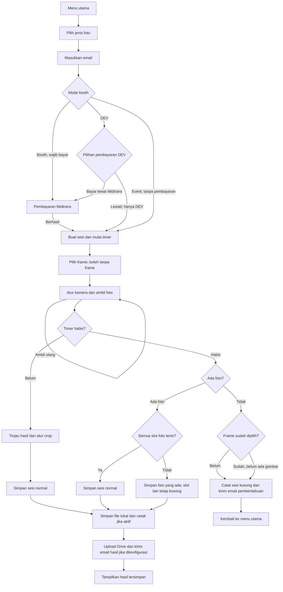

# Capturs Photobooth

## Product Requirements Document

**Versi:** 1.0  
**Diperbarui:** 21 November 2026  
**Status:** Menggambarkan produk dan alur yang tersedia saat ini

## Ringkasan produk

Capturs Photobooth adalah aplikasi photobooth desktop untuk menjalankan booth foto mandiri. Aplikasi booth dibuat dengan Electron dan React, lalu ditampilkan dalam mode kiosk agar pelanggan dapat memakai layar sentuh tanpa bantuan operator untuk setiap langkah.

Pelanggan memilih jenis foto, mengisi email, lalu menyelesaikan pembayaran sesuai mode booth. Sesi foto baru dimulai setelah pembayaran berhasil dan memiliki batas waktu yang dapat diatur operator. Pelanggan kemudian memilih frame, mengatur tampilan kamera, dan mengambil foto. Hasil sesi disimpan di komputer booth dan dapat dicetak otomatis. Jika diaktifkan, aplikasi juga mengunggah file foto ke Google Drive dan mengirim hasil atau pemberitahuan sesi ke email pelanggan.

Operator mengatur booth dari Admin Studio di aplikasi desktop. WebAdmin menjadi tempat pemilik melihat aktivitas beberapa booth, transaksi, sesi, dan mengubah konfigurasi booth yang terhubung.

## Masalah yang diselesaikan

Photobooth perlu menjalankan alur pelanggan yang sederhana di layar sentuh, sambil tetap memberi operator kendali atas kamera, frame, harga, pembayaran, printer, dan pengiriman hasil. Data foto juga harus tetap tersimpan di booth ketika koneksi cloud sedang tidak tersedia.

## Tujuan produk

- Membantu pelanggan menyelesaikan sesi foto sendiri dengan instruksi yang jelas.
- Mendukung pembayaran langsung, acara yang sudah membayar, dan mode pengembangan.
- Menghasilkan foto dengan frame dan efek yang dapat disesuaikan.
- Menyimpan hasil di perangkat booth dan mencetaknya lewat printer yang dipilih operator.
- Memberi pemilik ringkasan sesi dan transaksi dari WebAdmin.
- Menjaga foto dan kredensial sensitif tetap di perangkat, kecuali foto yang sengaja diunggah ke Google Drive.

## Pengguna

| Pengguna | Kebutuhan |
| --- | --- |
| Pelanggan | Mengikuti sesi foto dengan cepat, memilih hasil, dan menerima atau mencetak fotonya. |
| Operator booth | Menyiapkan perangkat, kamera, frame, pembayaran, penyimpanan, dan printer. |
| Pemilik/admin toko | Memantau sesi dan transaksi, mengelola booth, serta mengatur layanan online. |

## Bagian aplikasi

### Aplikasi booth

Aplikasi Electron berjalan di komputer booth dan menyediakan alur pelanggan, kamera, penyimpanan lokal, cetak otomatis, serta Admin Studio lokal.

### WebAdmin

WebAdmin berjalan sebagai aplikasi web terpisah. Pemilik dapat melihat ringkasan, sesi, transaksi, booth terdaftar, email pelanggan, dan Telegram. Konfigurasi kamera dan frame dapat dikelola per booth yang sudah disetujui.

### Arah visual

Antarmuka menggunakan palet Capturs secara global:

| Warna | Hex |
| --- | --- |
| Rose Kiss | `#fa699e` |
| Baby Pink | `#ff9fc7` |
| White | `#ffffff` |
| Lavender Blush | `#ffe7f0` |
| Cloudy Sky | `#4298ed` |

### Penyimpanan

- Konfigurasi booth dan kredensial tersimpan di komputer booth.
- File sesi tersimpan di `Documents/Capturs/storage/<id-sesi>/`.
- WebAdmin menerima informasi sesi dan transaksi yang diperlukan untuk laporan, bukan file foto.
- Google Drive bersifat opsional. Jika aktif, foto sesi diunggah dan pelanggan dapat membuka folder melalui QR. Masa retensi default adalah 7 hari.

## Alur pelanggan

### Rincian langkah

1. **Mulai sesi.** Pelanggan mengetuk tombol mulai. Data sementara dari sesi sebelumnya dibersihkan.
2. **Pilih jenis foto.** Pelanggan memilih photo strip atau foto tunggal. Masing-masing format memakai harga yang diatur terpisah di Admin Studio atau WebAdmin. Harga awal photo strip Rp35.000 dan foto tunggal Rp24.500.
3. **Isi email.** Setelah memilih jenis foto, pelanggan memasukkan email sebelum pembayaran. Email disimpan bersama sesi dan dipakai untuk mengirim hasil atau pemberitahuan.
4. **Pembayaran dan mulai sesi.** Booth mode mewajibkan pembayaran Midtrans. Sampai pembayaran terverifikasi berhasil, sesi aktif belum dibuat dan timer belum berjalan. DEV mode menyediakan pembayaran uji atau opsi lewati. Setelah pembayaran berhasil—atau pembayaran dilewati di DEV—aplikasi membuat sesi aktif dan memulai timer. Event mode memulai sesi setelah email karena biaya sesi ditanggung penyelenggara.
5. **Pilih frame.** Frame yang sesuai dengan jenis sesi ditampilkan. Pelanggan dapat memilih tanpa frame.
6. **Atur tampilan dan ambil foto.** Pelanggan memilih filter, Smooth Skin, dan Retouch. Kamera mengambil foto sesuai jenis sesi dan pelanggan dapat mengulang jepretan.
7. **Tinjau hasil.** Jika frame dipakai, pelanggan dapat mengatur posisi dan zoom foto pada setiap slot. Crop hasil dapat disimpan sebagai default preset frame.
8. **Batas waktu sesi.** Timer dimulai setelah pembayaran berhasil (atau setelah email pada Event mode); default 5 menit dan dapat diubah dari Pengaturan booth atau profil booth WebAdmin. Jika waktu habis dan pelanggan belum memilih frame, atau sudah memilih frame tetapi belum mengambil foto, sesi dicatat sebagai sesi kosong. WebAdmin mengirim email: “Kamu tidak melakukan apa pun pada sesi foto berbayar tadi. Jika merasa memerlukan bantuan, silakan hubungi operator booth untuk mendapatkan dukungan.” Jika photo strip sudah memiliki satu atau dua foto saat waktu habis, sistem menyimpan foto tersebut, membiarkan slot tersisa kosong, lalu memprosesnya melalui jalur hasil normal. `Hasil.png` tetap dibuat dengan slot kosong dan folder hasil berisi foto yang sempat diambil; email mengikuti pengaturan Drive dan email sesi biasa. Sesi yang seluruh slotnya sudah terisi tetap disimpan sebagai sesi normal meskipun timer habis.
9. **Simpan dan cetak.** Aplikasi membuat `Hasil.png`, file foto per jepretan, `Boomerang.gif`, dan `Live Photos.mp4` bila klip tersedia. Hasil disimpan lokal. Cetak otomatis mengikuti pengaturan printer; jika printer gagal, sesi tetap tersimpan dan operator melihat pesan kesalahan.
10. **Tampilkan hasil.** Pelanggan melihat preview dan, bila Drive aktif, QR untuk membuka folder hasil. Dalam Booth dan Event mode, layar kembali ke menu utama otomatis setelah 30 detik; DEV mode menunggu pelanggan menekan tombol kembali.

## Mode operasional dan aturan pembayaran

| Mode | Aturan |
| --- | --- |
| DEV | Untuk pengembangan. Pembayaran dapat memakai Midtrans atau dilewati. |
| Booth | Untuk penggunaan normal. Pembayaran Midtrans wajib dan status transaksi diperiksa sebelum sesi disimpan. |
| Event | Biaya ditanggung penyelenggara. Langkah pembayaran dilewati dan sesi dicatat sebagai sesi event. |

## Alur operator dan admin

1. Dari menu utama, operator menekan `Ctrl+Z`.
2. Operator memasukkan password admin.
3. Admin Studio terbuka dengan menu berikut:
   - **Ringkasan:** aktivitas sesi lokal dan status perangkat.
   - **Koneksi data:** Midtrans, lokasi penyimpanan, Google Drive, dan pengaturan koneksi yang tersedia.
   - **Pengaturan booth:** nama booth, ID toko, mode operasional, harga photo strip dan foto tunggal, serta batas waktu sesi (1–60 menit; default 5 menit).
   - **Camera settings:** memilih perangkat kamera dan kontrol yang didukung kamera.
   - **Booth Frames:** mengelola PNG, slot, dan preset frame.
   - **Printer settings:** memilih printer, ukuran kertas 4×6, 4×8, A3, A4, atau ukuran default printer; mengatur salinan, warna, cetak otomatis, dan mencetak halaman tes.
   - **Sinkronisasi cloud:** menghubungkan booth ke WebAdmin dan mengatur Telegram.
4. Operator menyimpan perubahan. Pengaturan printer berlaku lokal pada booth yang sedang diatur.

Pada build saat ini, password admin desktop masih berupa password awal prototipe `admin`. Pengaturan URI MongoDB tersedia di UI, tetapi konektor MongoDB langsung pada aplikasi desktop belum aktif.

## Persyaratan fungsional

| ID | Persyaratan |
| --- | --- |
| FR-01 | Alur pelanggan dapat dijalankan melalui kontrol sentuh dari menu utama sampai hasil sesi. |
| FR-02 | Photo strip dan foto tunggal memakai harga mandiri yang masing-masing dapat diubah operator; jenis sesi dan mode menentukan total pembayaran. |
| FR-03 | Pelanggan memilih jenis foto, mengisi email valid sebelum pembayaran, lalu memilih frame atau tanpa frame setelah sesi dimulai. |
| FR-04 | Kamera menampilkan preview, menerapkan pengaturan tampilan, mengambil foto, dan mendukung pengulangan. |
| FR-05 | Hasil sesi disimpan lokal beserta metadata sesi dan file pendukung yang berhasil dibuat. |
| FR-06 | Printer dapat dipilih dari daftar perangkat komputer, atau memakai printer default. Pengaturan cetak meliputi ukuran kertas, jumlah salinan, warna, dan cetak otomatis. |
| FR-07 | Kegagalan printer atau layanan cloud tidak boleh menghapus hasil sesi yang sudah tersimpan lokal. |
| FR-08 | Google Drive dapat diaktifkan untuk upload hasil, menampilkan QR, dan menerapkan retensi folder. |
| FR-09 | Booth yang disetujui dapat mengirim metadata sesi dan transaksi ke WebAdmin saat koneksi tersedia. |
| FR-10 | Kredensial sensitif disimpan di perangkat booth dan tidak dikirim sebagai konfigurasi publik ke WebAdmin. |
| FR-11 | Operator dapat memperbarui konfigurasi kamera, frame, identitas booth, mode, harga, durasi sesi, dan printer melalui Admin Studio atau WebAdmin. |
| FR-12 | Dalam Booth mode, sesi aktif baru dibuat setelah pembayaran Midtrans terverifikasi berhasil; timer tidak berjalan sebelum itu. DEV dapat melewati pembayaran, sedangkan Event memulai sesi setelah email. |
| FR-13 | Durasi timer sesi dapat diatur antara 1–60 menit, dengan default 5 menit. |
| FR-14 | Jika timer habis tanpa frame dipilih atau frame sudah dipilih tetapi belum ada foto, sistem mencatat sesi kosong dan mengirim email pemberitahuan agar pelanggan dapat menghubungi operator untuk bantuan. |
| FR-15 | Jika timer habis setelah satu atau dua foto photo strip diambil, sistem menyimpan foto yang tersedia sebagai sesi parsial, membiarkan slot yang belum diisi kosong, dan memproses hasil melalui jalur email sesi normal. |

## Kebutuhan nonfungsional

- Antarmuka pelanggan harus mudah dibaca dan dioperasikan dengan sentuhan.
- Aplikasi booth harus mempertahankan salinan sesi lokal jika internet atau layanan pihak ketiga sedang bermasalah.
- Perubahan WebAdmin tidak boleh diterapkan ketika pelanggan sedang memakai booth; aplikasi menerapkannya setelah sesi selesai melalui maintenance flow.
- File foto dan video tidak dikirim ke WebAdmin. Upload ke Google Drive hanya berlangsung jika operator mengaktifkannya.
- Kunci Midtrans dan kredensial Google disimpan menggunakan penyimpanan aman Electron di komputer booth.

## Penanganan kondisi khusus

- **Pembayaran belum terkonfirmasi:** pelanggan belum dapat meneruskan sesi Booth mode.
- **Kamera tidak tersedia:** aplikasi menampilkan placeholder kamera dan tetap menyediakan foto demo agar alur bisa dicoba. Foto demo bukan hasil kamera nyata.
- **Frame gagal dimuat:** aplikasi memberi pesan dan menahan langkah menuju pengambilan foto.
- **Printer tidak tersedia atau gagal:** sesi tetap tersimpan; error cetak ditampilkan di layar hasil.
- **Google Drive atau WebAdmin offline:** sesi tetap tersimpan lokal; sinkronisasi atau upload ditangani terpisah dan dapat tertunda.

## Keberhasilan produk

Ukuran keberhasilan yang perlu dipantau dari penggunaan nyata:

- Persentase sesi yang selesai tanpa bantuan operator.
- Waktu rata-rata dari mulai sesi sampai hasil tersimpan.
- Persentase pembayaran yang berhasil diverifikasi.
- Persentase sesi yang berhasil dicetak.
- Persentase upload Drive dan sinkronisasi WebAdmin yang berhasil.
- Jumlah sesi yang memerlukan foto ulang atau bantuan operator.

Target angka untuk metrik tersebut ditetapkan setelah tersedia data pemakaian booth.

## Catatan pengembangan berikutnya

- Ganti password admin prototipe dengan mekanisme akses yang dapat dikelola operator.
- Implementasikan atau hapus pengaturan MongoDB desktop yang saat ini belum memiliki konektor aktif.
- Tetapkan target produk untuk metrik penyelesaian sesi, durasi, cetak, dan sinkronisasi setelah uji lapangan.
