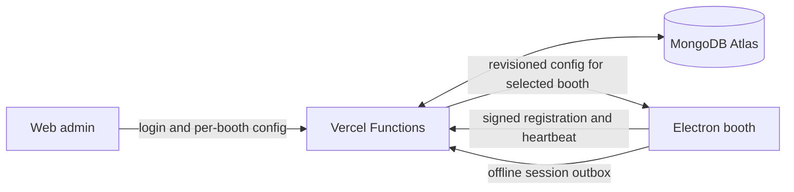

# Capturs Web Admin

Web dashboard and Vercel Functions for the Capturs Photobooth Electron app. Deploy this directory as the Vercel project root.

## Local development

Copy `.env.example` to `.env.local` and fill in private values. Run `npm run dev:webadmin` from the repository root, or `npm run dev` from this directory. The UI and local API handlers run together at `http://127.0.0.1:4114`; the command does not invoke the Vercel CLI or require a Vercel project link. Local API routes call the same handlers used in production.

`npm run build && npm run preview` serves a static frontend build on port `4114`; static preview does not run API handlers. Vercel production deployments use the platform's HTTPS domain and do not bind to a user-selected public port.

## Vercel environment

Set these variables in Vercel Project Settings → Environment Variables:

- `MONGODB_URI`: server-only Atlas connection string.
- `MONGODB_DATABASE`: database name, for example `capturs`.
- `ADMIN_EMAIL` and `ADMIN_PASSWORD`: owner login.
- `SESSION_SECRET`: random signing secret, at least 32 random bytes.

Do not use a `VITE_` prefix on any secret. The browser only talks to `/api`; it never connects directly to MongoDB.

## Connect and manage booths

In the desktop app, open **Admin → Sinkronisasi cloud**, enter the Web Admin URL, and save. The app creates a unique Ed25519 device identity automatically; there is no API key to copy. The booth appears under **Perangkat booth** as pending. Approve it once before it can upload logs or receive remote configuration.

Configuration belongs to an individual approved booth. Select the booth in **Pengaturan** to edit its name, separate photo strip and single photo prices, operation mode, Midtrans environment and Client Key, Google Drive destination and retention, camera settings, and frame collection. Google OAuth credentials and refresh tokens stay local to each booth. The desktop app also publishes its allowed local admin settings to that booth's cloud configuration. Revisions prevent an old local copy from silently overwriting a newer web edit.

Revoking a booth disables its access and keeps the row as an audit record. Once revoked, **Hapus entry permanen** removes it from the device list and deletes its remote config, while preserving transaction, session, and app-run history with the booth name captured on those records. A tombstone prevents the removed device identity from registering again. Booth names are not unique; device IDs distinguish booths.

The app checks cloud revisions about every 8–10 seconds, including during a customer session, but never applies config or frames mid-session. When an admin starts a config or frame save, WebAdmin marks that booth as applying; the app waits for the save to finish before entering **MAINTENANCE MODE**. An active session and its 30-second printing page finish first, and the booth then syncs the final config, frame manifest, missing PNG assets, and local session/payment/run outbox. Electron verifies cloud revisions and an empty local outbox before relaunching, and repeats the sync if anything is still pending. Queued log delivery continues in the background. Frame metadata and small thumbnails live in a separate manifest. SHA-256 hashes identify image content: unchanged assets are not uploaded again, and an identical manifest does not create a new revision. Full PNGs are separate per-frame assets; ordinary browsing downloads only the selected frame, while maintenance downloads all missing assets with hashes verified. The open Web Admin settings page checks the selected booth's revisions every 5 seconds and reloads config/frame data only after changes, while preserving fields with unsaved edits. Ordinary config reads and writes never include the PNG collection. While offline, the booth continues using local settings and retries queued logs after reconnecting.

The booth sends an app-run timestamp, locally verified paid orders, and completed session summaries with customer email and Google Drive link. Images, MongoDB credentials, Midtrans Server Key, Google OAuth secrets, refresh tokens, and local storage paths stay on the device. Existing token-paired devices migrate to signed identity automatically when they reconnect.

## Telegram notifications

Telegram runs inside the Electron app from `tele/bot.cjs`; there is no separate worker or Telegram encryption key to deploy. The bot token stays encrypted on the booth using Electron `safeStorage`. Send `/id` to the bot from the destination chat and the app stores its Chat ID automatically. The app sends only that Chat ID to the signed API, polls the MongoDB notification outbox, and delivers logs while the booth is online. If the app is closed or offline, WebAdmin keeps events queued until it reconnects. The bot logs booth runs, payments, sessions, settings/device changes, and frame additions, edits, and removals. Notifications omit customer email, Drive links, and secret values.

The **Telegram** page in WebAdmin displays the linked booth and lets an admin change or clear the destination Chat ID. The token remains in the desktop app; WebAdmin never stores it.

## API map

- `POST /api/login`, `POST /api/logout`, `GET /api/me`: admin session.
- `GET /api/settings`: legacy store defaults and status.
- `GET/PUT /api/email-settings`, `POST /api/email-settings-test`: global SMTP or Gmail App Password settings and connection check.
- `POST /api/email-retry`: admin-only retry for a failed customer email after Drive upload.
- `GET/POST/DELETE /api/devices`: list, approve or rename, and revoke booths.
- `GET/PUT /api/device-config?deviceId=...`: admin edits one booth's config; GET accepts `revision=N&frameRevision=N` for a small unchanged response.
- `POST /api/device-maintenance`: marks a booth's WebAdmin save as applying or ready so Electron waits for the complete config/frame transaction.
- `GET/PUT /api/device-frames?deviceId=...`: admin reads or updates one booth's frame manifest; add `revision=N` to a GET for a small unchanged response.
- `GET /api/device-frames?deviceId=...&frameId=...&format=png`: admin downloads one binary PNG with its SHA-256 response header; the default GET still returns JSON for compatibility.
- `PUT /api/device-frames?deviceId=...&frameId=...`: admin uploads one frame PNG as a data URL; the server stores it by content hash.
- `POST /api/device/register`: signed automatic enrollment.
- `PUT /api/device/telegram`: signed booth setup for the destination Chat ID only; the bot token stays on the booth.
- `POST /api/device/telegram-events`: signed booth claim and acknowledgement for queued Telegram notifications.
- `GET/PUT /api/telegram`: admin reads or changes the notification Chat ID without access to the bot token.
- `POST /api/device/identity`: one-time migration for legacy bearer pairing.
- `GET/PUT /api/device/sync`: signed booth config read/write.
- `GET /api/device/updates`: signed revision and maintenance-state check; the booth downloads full data only after a completed WebAdmin save.
- `GET/PUT /api/device/frames`: signed booth frame manifest read/write; `GET?revision=N` returns only revision metadata when unchanged.
- `GET /api/device/frame?frameId=...&format=png`: signed booth downloads one binary PNG with its SHA-256 response header; the default GET still returns JSON for compatibility.
- `PUT /api/device/frame?frameId=...`: signed booth uploads one frame PNG as a data URL; the server stores it by content hash.
- `POST /api/device/runs`: app launch timestamp.
- `POST /api/device/payments`: locally verified paid-order log.
- `POST /api/device/sessions`: idempotent session summary ingestion.
- `GET /api/payments`: transaction history with booth, customer email, and Drive link.
- `GET /api/dashboard`: metrics, seven-day chart, and latest sessions.
